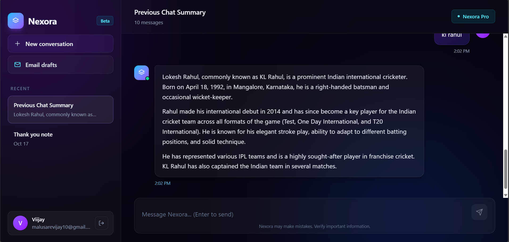
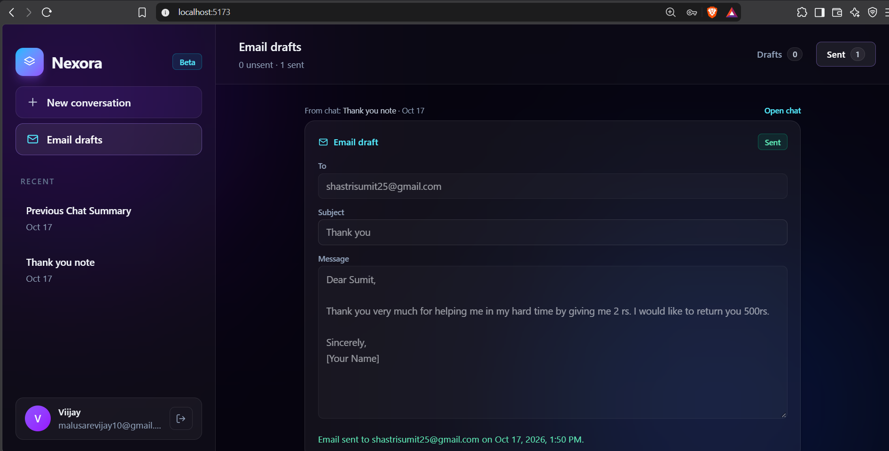

# ✨ Nexora — Your AI-Powered Personal Assistant

<p align="center">
  
  
  
</p>

<p align="center">
  <b>Your intelligent assistant for conversations, research, and email productivity.</b>
  <br>
  Built to make everyday digital tasks smarter, faster, and easier.
</p>

---

## 📌 About Nexora

**Nexora** is a full-stack, AI-powered personal assistant designed to help users interact with artificial intelligence through a conversational interface.

Instead of switching between different tools for asking questions, researching information, and managing emails, Nexora brings these capabilities together in one application.

Powered by modern AI technologies, Nexora combines conversational AI, recent chat history, internet search, and email assistance to create a more practical and personalized user experience.

The project focuses on building a real-world AI application that combines intelligent responses with useful productivity features.

## 🚀 Key Features

### 🤖 AI-Powered Conversations

* Interact with an AI assistant through a conversational interface.
* Ask questions and receive AI-generated responses.
* Create new conversations for different topics.
* Maintain recent conversation context to support more continuous interactions.

### 🧠 Recent Conversation Memory

* Save recent conversations for convenient access.
* Retain the latest chat history to help users continue previous discussions.
* Retrieve recent conversation context when supported by the application.
* Manage conversations through backend APIs.

### 📧 AI Email Assistant

* Generate email drafts using AI.
* Turn simple instructions into structured email content.
* Send emails through an integrated email service.
* Reduce the time spent writing repetitive or professional emails.

### 🌐 Internet Search

* Integrate internet search capabilities into the AI assistant.
* Retrieve relevant information from online sources when the search functionality is invoked.
* Support information-seeking tasks beyond general conversational responses.

### 🔐 User Authentication

* Provide authentication functionality for user accounts.
* Support protected application features through the authentication system.
* Manage authentication state on the frontend.

### 🎨 Modern User Interface

* Responsive, chat-oriented interface.
* Clean layout designed for distraction-free conversations.
* Dedicated email assistance functionality.
* Modern visual identity with a purple gradient theme.

---

## 🛠️ Tech Stack

Nexora uses a modern full-stack JavaScript architecture.

| Technology    | Purpose                                           |
| ------------- | ------------------------------------------------- |
| React         | Frontend user interface                           |
| Redux Toolkit | Frontend state management                         |
| Node.js       | Backend JavaScript runtime                        |
| Express.js    | Backend API and routing                           |
| MongoDB       | Database and persistent application data          |
| LangChain     | AI orchestration and agent workflows              |
| Google Gemini | AI-powered response generation                    |
| Nodemailer    | Email delivery                                    |
| Axios         | HTTP requests between frontend and backend        |
| Zod           | Schema validation for structured inputs and tools |
| Git & GitHub  | Version control and source code management        |

**Note:** The technologies listed above reflect the project's intended architecture. Adjust this table if your current implementation differs.

---


## 📸 Screenshots

### AI Chat


### Email Assistant


## 🏗️ Application Architecture

Nexora follows a client-server architecture in which the frontend communicates with a backend API, which coordinates authentication, database operations, AI processing, internet search, and email delivery.

```text
                   ┌────────────────────────┐
                   │         User           │
                   └───────────┬────────────┘
                               │
                               ▼
                   ┌────────────────────────┐
                   │     React Frontend     │
                   │                        │
                   │  Chat Interface        │
                   │  Email Assistant       │
                   │  Authentication UI     │
                   └───────────┬────────────┘
                               │
                         HTTP / Axios
                               │
                               ▼
                   ┌────────────────────────┐
                   │    Express Backend     │
                   │                        │
                   │  Authentication        │
                   │  Chat Management       │
                   │  Email APIs            │
                   │  AI Integration        │
                   └───────────┬────────────┘
                               │
                 ┌─────────────┼──────────────┐
                 │             │              │
                 ▼             ▼              ▼
          ┌────────────┐ ┌────────────┐ ┌────────────┐
          │  MongoDB   │ │ Gemini AI  │ │ Nodemailer │
          │            │ │            │ │            │
          │ Chat Data  │ │ AI Replies │ │ Email      │
          │ User Data  │ │ AI Agents  │ │ Delivery   │
          └────────────┘ └─────┬──────┘ └────────────┘
                               │
                               ▼
                      ┌────────────────┐
                      │ Internet Search│
                      │ Integration    │
                      └────────────────┘
```

### How It Works

1. The user interacts with Nexora through the React frontend.
2. The frontend sends requests to the Express backend.
3. The backend processes the request and determines the required operation.
4. For AI-related requests, the backend invokes the configured Gemini model through LangChain.
5. When appropriate, the AI workflow can use the integrated internet search functionality.
6. Conversation data is stored or retrieved through MongoDB and the application's chat-management logic.
7. For email tasks, the backend generates the requested content and uses Nodemailer to send emails.
8. The backend returns the result to the frontend for display.

---

## 📂 Project Structure

The following is an example of how the project can be organized. Update the paths to match your actual repository.

```text
Nexora/
│
├── frontend/
│   ├── public/
│   ├── src/
│   │   ├── components/
│   │   ├── pages/
│   │   ├── redux/
│   │   ├── services/
│   │   ├── App.jsx
│   │   └── main.jsx
│   ├── package.json
│   └── .env
│
├── backend/
│   ├── controllers/
│   ├── models/
│   ├── routes/
│   ├── middleware/
│   ├── services/
│   ├── config/
│   ├── app.js
│   ├── server.js
│   ├── package.json
│   └── .env
│
├── .gitignore
└── README.md
```

**Important:** This is a reference structure, not a claim about your exact folder layout. Preserve your existing project structure when updating this section.

---

## ⚙️ Getting Started

Follow these instructions to run Nexora locally.

### Prerequisites

Make sure you have installed:

* [Node.js](https://nodejs.org/)
* npm, included with Node.js
* A MongoDB database, either local or hosted
* A Google Gemini API key
* Git

Email functionality also requires the email service credentials and configuration used by your backend.

### 1. Clone the Repository

```bash
git clone YOUR_GITHUB_REPOSITORY_URL
```

Navigate to the project directory:

```bash
cd Nexora
```

Replace `YOUR_GITHUB_REPOSITORY_URL` with your actual repository URL.

### 2. Install Dependencies

Install the frontend dependencies:

```bash
cd frontend
npm install
```

Install the backend dependencies in a separate terminal:

```bash
cd backend
npm install
```

If your repository uses different folder names, run these commands from the directories containing the corresponding `package.json` files.

### 3. Configure Environment Variables

Create the required environment files based on your existing configuration.

**Backend `.env`**

```env
PORT=5000
MONGODB_URI=your_mongodb_connection_string
GEMINI_API_KEY=your_gemini_api_key
```

Add any additional variables required by your application, such as authentication secrets, email credentials, OAuth configuration, and internet search API keys.

**Frontend `.env`**

For a Vite-based React application:

```env
VITE_API_URL=http://localhost:5000/api
```

For a Create React App application, use the appropriate `REACT_APP_` variable instead.

The environment variable names and API URL must match the values expected by your actual source code.

**Security reminder:** Never commit `.env` files, API keys, database credentials, OAuth client secrets, or other sensitive information to GitHub.

### 4. Start the Backend

Open a terminal in the backend directory:

```bash
npm run dev
```

If your project uses a different development script, use the command defined in your backend `package.json`.

### 5. Start the Frontend

Open another terminal in the frontend directory:

```bash
npm run dev
```

For a Vite application, the terminal will display the local development URL, commonly:

```text
http://localhost:5173
```

Open that URL in your browser.

Your frontend and backend should now be running locally.

---

## 🔑 Environment Configuration

Nexora may require the following environment variables, depending on the features enabled in your implementation.

| Variable               | Description                                          |
| ---------------------- | ---------------------------------------------------- |
| `PORT`                 | Backend server port                                  |
| `MONGODB_URI`          | MongoDB connection string                            |
| `GEMINI_API_KEY`       | Google Gemini API key                                |
| `JWT_SECRET`           | Secret used for JWT authentication, if implemented   |
| `CLIENT_URL`           | Frontend URL used by the backend                     |
| `EMAIL_USER`           | Email account used for sending emails, if configured |
| `EMAIL_PASS`           | Email password or app password, if configured        |
| `GOOGLE_CLIENT_ID`     | Google OAuth client ID, if required                  |
| `GOOGLE_CLIENT_SECRET` | Google OAuth client secret, if required              |
| `GOOGLE_REFRESH_TOKEN` | Google OAuth refresh token, if required              |
| `SEARCH_API_KEY`       | Internet search API key, if required                 |

This is a configuration reference, not a list of universally required variables. Use the names and authentication method implemented in your application.

Never publish real credential values in this table.

---

## 📡 Core Functional Modules

### 1. Authentication Module

Responsible for user authentication and related account operations.

Depending on the implementation, this module may include:

* User registration and login.
* Credential validation.
* Authentication state management.
* Protected API routes.

### 2. AI Conversation Module

Handles the interaction between users and the configured AI model.

Its responsibilities include:

* Receiving user messages.
* Preparing conversation context.
* Invoking the AI model.
* Returning generated responses.
* Integrating search tools when appropriate.

### 3. Conversation Management Module

Manages recent chat history and conversation-related operations.

Possible operations include:

* Saving conversation messages.
* Retrieving recent conversations.
* Maintaining relevant conversational context.
* Deleting conversations through the chat-management API.

### 4. Email Assistant Module

Supports AI-assisted email creation and delivery.

The general workflow is:

```text
User Instruction
       |
       ▼
AI Email Draft Generation
       |
       ▼
Review Email Content
       |
       ▼
Email Sending API
       |
       ▼
Nodemailer / Configured Email Service
       |
       ▼
Recipient's Inbox
```

Email delivery depends on valid credentials, the configured email provider, and its authentication requirements.

### 5. Internet Search Module

Connects the AI workflow to an external search service.

When invoked, the search integration can retrieve relevant information and provide results for the assistant to use when generating a response.

Search availability depends on the configured provider and API credentials.

---

## 🔒 Security Considerations

Nexora integrates several services that require careful credential and data management.

Recommended security practices include:

* Store API keys and secrets in environment variables.
* Exclude `.env` files from version control.
* Never expose backend secrets in frontend code.
* Validate incoming API requests.
* Protect authenticated endpoints with appropriate middleware.
* Configure CORS to allow only the intended frontend origins in production.
* Use HTTPS for production deployments.
* Handle authentication tokens securely.
* Avoid logging passwords, tokens, or sensitive email content.
* Validate email recipients and message inputs before sending.
* Apply appropriate rate limits to authentication, AI, and email endpoints.
* Restrict database access and use secure MongoDB credentials.

If an API key or secret has already been pushed to a public repository, revoke or rotate it. Deleting it from the latest commit alone does not invalidate an exposed credential.

---

## 🌍 Deployment

Nexora can be deployed using separate frontend and backend hosting services.

A possible deployment architecture is:

| Component                   | Hosting Option                    |
| --------------------------- | --------------------------------- |
| React frontend              | Vercel                            |
| Node.js and Express backend | Render                            |
| MongoDB database            | MongoDB Atlas                     |
| AI services                 | Google Gemini API                 |
| Email delivery              | Configured SMTP or email provider |

### Deployment Overview

1. Deploy the backend and configure its production environment variables.
2. Configure the MongoDB connection and production database permissions.
3. Set up the frontend URL in the backend's CORS configuration.
4. Deploy the frontend and configure its API base URL.
5. Verify authentication, AI responses, chat history, and email delivery.
6. Test all environment-dependent features in production.

**Deployment status:** Update this section once Nexora is publicly deployed. Do not label the application as live until the production deployment has been tested.

---

## 🧪 Testing

Before releasing a production version, verify the following:

* [ ] User registration and login work correctly.
* [ ] Invalid credentials are handled appropriately.
* [ ] AI conversations return valid responses.
* [ ] Recent conversation history is saved and retrieved correctly.
* [ ] Internet search integration works with valid configuration.
* [ ] Email drafts are generated correctly.
* [ ] Emails are sent from the intended email account.
* [ ] Failed email deliveries produce understandable errors.
* [ ] Chat deletion works correctly.
* [ ] API requests handle invalid input and server errors.
* [ ] Environment variables are configured correctly.
* [ ] The production frontend can communicate with the backend.
* [ ] Sensitive credentials are not exposed to the browser or GitHub.

---

## 🔮 Future Enhancements

Potential improvements for future versions of Nexora include:

* **Long-term conversational memory:** Retain useful context across multiple sessions.
* **Multiple AI models:** Allow users to select between supported language models.
* **Document interaction:** Upload and query documents using retrieval-augmented generation (RAG).
* **Conversation search:** Find earlier conversations using keywords.
* **Advanced email workflows:** Add email templates, draft management, and improved recipient handling.
* **Voice interaction:** Support speech-to-text and text-to-speech.
* **Personalization:** Allow users to configure assistant preferences.
* **Usage monitoring:** Track API consumption and manage rate limits.
* **Improved security:** Introduce stronger authorization controls and more comprehensive audit logging.
* **Automated testing:** Add unit, integration, and end-to-end tests.

These are potential enhancements rather than features guaranteed to exist in the current version.

---

## 🎯 Project Objectives

Nexora was developed to explore how modern web technologies and large language models can be combined to create a practical AI-powered productivity application.

The main objectives are:

1. Build a full-stack AI assistant with a user-friendly interface.
2. Integrate a large language model into a web application.
3. Maintain recent conversational context.
4. Simplify email composition through AI-generated drafts.
5. Connect AI workflows with external search functionality.
6. Develop experience in backend APIs, database integration, authentication, and third-party services.
7. Apply software development concepts to a real-world project.

---

## 👨‍💻 Author

**Vijay Malusare**

Full Stack Developer | AI Application Development

GitHub: [@vijaym105](https://github.com/vijaym105)

---

## 📄 License

Choose an appropriate license before distributing Nexora publicly.

If you intend to make the source code available for reuse, consider adding an MIT License in a `LICENSE` file and updating this section accordingly.

---

<p align="center">
  <b>Nexora</b>
  <br>
  Your ideas. Your conversations. One intelligent assistant.
</p>
